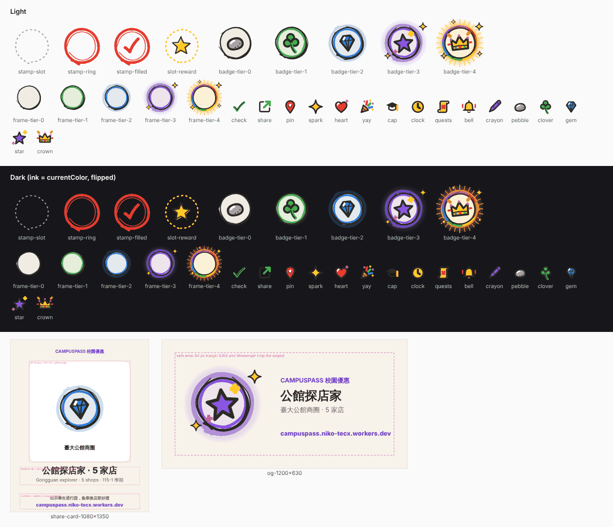

# CampusPass stamps: gamification design package

For the UI owner's mock-up. The direction is approved for a mock-up; the founder decides after seeing it beside the 商圈 mock-up.

The rule behind every screen: **a stamp is a pass a shop confirmed** (`redemptions.confirmed_at`). Opening a pass, saving or viewing a deal earns nothing.

## Screens and states

**1. Stamp moment (pass screen).** The pass already polls `GET /api/redemptions/:code`. When `confirmed_at` appears, `stamp-filled` drops on: scale 1.6→1, rotate −12°→−4°, three `icon-spark`s, about 300 ms on `--ease-sheet`, transform and opacity only (reduced motion: it just appears). Then a stamp-card line and an optional **分享 Share**. States: stamped; already stamped here today; reward due; daily cap reached (quiet, not an error).

**2. Stamp page (我的 › 集章).** Term album on top, then 商圈 badges, then one card per shop. Empty state copy below.

**3. 商圈 badges.** A frame with an icon, the 商圈 name and progress beneath. Tiers are earned, never random: 0 locked, 1 first shop, 2 **the badge** (5 shops; 3 in the pilot), 3 ten shops, 4 every partner shop there. MVP shows three: 臺大公館商圈, 南西心中山商圈 and 永康商圈 (28, 9 and 8 mapped deals in `data/deal-districts.json`).

**4. Shop stamp card.** N slots: `stamp-slot` empty, `stamp-ring` with the shop's first character when filled, `stamp-slot-reward` on the Nth with the shop's reward text. **The cashier sees it too:** after confirming, `/m/<key>` shows 「第 {n} 次來店 → 請給予：{perk}」.

**5. Term album.** Counts **active weeks** (any stamp that week), never streaks; a missed week costs nothing. Closes at term end and stays viewable.

**6. College board.** Self-declared college (NTU's 17, `src/departments.ts`), changeable any time. Ranked by **distinct shops per student** this term; a college shows only with at least 5 stamped students. No individual is ever listed.

**7. Share card.** Opt-in per share; layout below.

## Data

| Screen | Existing | New |
|---|---|---|
| Stamp moment | `redemptions.confirmed_at`, `confirmed_key` | stamp count for (user, shop) from `stamps` |
| Stamp page, badges | `deals`, `data/deal-districts.json`, `data/districts.json` | `stamps` view |
| Shop card, cashier | `merchant_keys.label`, `deal_ids` | `merchant_keys.perk_every_n INTEGER`, `perk_text TEXT`, `shop_id TEXT` |
| Album | `stamps` | `terms (id, name_zh, name_en, starts_on, ends_on)` |
| College board | `user_identities` | `user_identities.college TEXT`, a nightly aggregate |
| Share | — | `shares (id, user_id, kind, district_id, shop_id, headline, subline, created_at)` |

`stamps` is a view: one row per user, `shop_id` and Taipei day (`date(confirmed_at,'+8 hours')`), over rows with `confirmed_at` set and `voided_at` (new, on `redemptions`) empty, excluding `user_id = 0` and `dev:` logins (the `REAL` predicate in `src/index.ts`). `shop_id` stays stable when a leaked link is reissued, so cards don't reset. Account deletion already moves confirmed redemptions to `user_id = 0`, so stamps vanish with it; add `shares` to that batch.

## Art (art/, about 115 KB)

Emitted from fishpond's crayon set (the founder's, made with Claude) by its own icon data and seeded generator; no player drawing or database content. Outlines are `currentColor` (default `#2B2A26`), so inline SVG follows `--ink` in dark mode. Keep the crayon look to the game layer; the rest of the app stays Tecxmate.

| File | Use |
|---|---|
| `stamp-ring`, `stamp-filled`, `stamp-slot`, `stamp-slot-reward` | stamp moment, shop card slots |
| `frame-tier-0…4` | empty badge frames; put a 商圈 icon inside |
| `badge-tier-0…4` | frame plus the tier icon (pebble, clover, gem, star, crown) |
| `icon-check`, `share`, `pin`, `spark`, `heart`, `yay`, `cap`, `clock`, `quests`, `bell`, `crayon` | confirmed, share, 商圈, sparkle, saved, reward, college board, album weeks, album, alerts |
| `share-card-1080x1350`, `og-1200x630` | layout guides (the pink dashed boxes are guides) |

For tier-4 motion, copy fishpond's `fishcard.css` aura (transform and opacity only). Skip its sun-driven palette (`daylight.js`): a pass is used at a counter, and its QR must stay dark on white.

## Share card

The 1080×1350 card follows fishpond's `share.js` layout:
- the eyebrow at y 104;
- a white 792² art window at y 168;
- the headline (68 px) at 1048 and the subline (36 px) at 1114, shrunk to fit and never wrapped;
- the invitation at 1252 and the address at 1308.

Drawn on the phone with canvas in the system font; shared as an image, else a link, else a download.

OG 1200×630 keeps a 64 px safe margin. Fishpond's `raster.js` draws strokes, not text, so render the five tier images offline as static PNGs and put specifics in `og:title` and `og:description` on `/s/:id`. Words come from the database, never the request; `/s/:id` returns 404 once the share or account is gone.

**May show:** badge art, the 商圈 name, counts of shops or stamps, the term, the brand and the address. A reward card may show that one shop's name.
**Never:** the student's name, Google photo, email, college (unless the student chose to show it), dates or times, the list of shops, or a map.

## Copy

| Key | 中文 | English |
|---|---|---|
| stamped | 蓋章！{shop} 第 {n} 章 | Stamped! Stamp {n} at {shop} |
| toGo | 再 {k} 次：{perk} | {k} more visits: {perk} |
| rewardNow | 這次可兌換：{perk} | Your reward today: {perk} |
| sameDay | 今天已在這家店蓋過章 | Already stamped here today |
| empty | 在合作店家出示通行證，店家確認後就會蓋章。 | Show your pass at a partner shop. You get a stamp when the shop confirms it. |
| onlyConfirmed | 只有店家確認才算，打開或收藏優惠不會蓋章。 | Only shop-confirmed passes count. Opening or saving a deal doesn't. |
| badge | 公館探店家 · {n}/5 家店 | Gongguan explorer · {n} of 5 shops |
| album | 115-1 學期冊 · 活躍 {n} 週 | Fall 2026 album · active {n} weeks |
| board | 學院榜 · 平均每人 {x} 家店 | Colleges · {x} shops per student |
| boardMin | 學院至少 5 位同學才會上榜 | A college appears once 5 students join |
| pickCollege | 選擇你的學院（自填，可隨時更改） | Pick your college (self-declared, change any time) |
| sharePrivacy | 卡片不會顯示你的名字、照片或時間 | The card never shows your name, photo or times |
| noValue | 集章沒有現金價值，不能轉讓、購買或跨店使用 | Stamps have no cash value and can't be transferred, bought or used at another shop |

## Economy

Shops fund their own rewards and pay for featured placement, double-stamp weeks or a 商圈 trail (a sponsored badge). Stamps have no cash value and cannot be transferred, bought or used at another shop.

## Do not build

Cross-shop points, cash-out, lotteries or gacha, login streaks, individual leaderboards, referral points, GPS check-ins, free text of any kind.

## Lessons from fishpond that apply

- **No streaks.** A streak punishes rain and exams; count active weeks instead.
- **College aggregates only.** An individual board turns a gift into a contest.
- **The server decides.** The client never sends a count, tier or headline.
- **No free text.** That leaves almost nothing to moderate.

## Risks

- **Fake confirmations, leaked shop link:** revocable links (`shop_id` keeps cards), stamp caps per user per day (suggest 5) and per shop, no `dev:` logins, an alert at 3× a shop's 4-week median, voiding by `voided_at`.
- **Privacy:** stamps reveal where someone shops. Sharing is opt-in and coarse, the board is aggregate only, stamps go with the account.

## Questions for a lawyer

1. Stored value and 禮券 rules under Taiwan's 電子支付 regulations.
2. Prize limits under the 公平交易法 (Fair Trade Act).
3. Consent under the 個資法 (Personal Data Protection Act) for stamp history and college.
4. Use of the NTU name and college names.

## Two-week MVP

1. Stamps derived from confirmed redemptions (the view, plus `voided_at`).
2. A stamp page with three 商圈 badges.
3. The stamp animation when the pass sees the confirmation.
4. `perk_every_n` and `perk_text` on each shop link, shown to the cashier.
5. A share card, plus `/s/:id` and the OG image.
6. A pilot with 3–5 shops in 公館.
